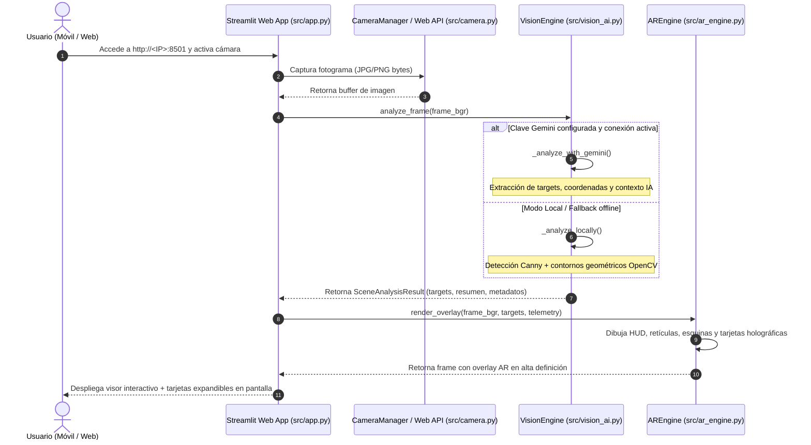

# 🗺️ Mapa de Arquitectura: Jarvis AR (Spatial Intelligence)

**Versión:** 1.0.0  
**Ecosistema:** NEXO Framework v2.3  
**Stack Tecnológico:** Python 3.12, Streamlit, OpenCV, Google GenAI SDK, Pydantic, Pytest

---

## 🏛️ Flujo General de Datos y Pipeline de Inferencia

---

## 🧩 Componentes y Responsabilidades

| Componente | Archivo | Responsabilidad Principal |
| :--- | :--- | :--- |
| **Configuración Segura** | [`src/config.py`](file:///c:/Users/User/Documents/Realidad_AI/src/config.py) | Carga tipada de `.env`, validación de puertos y rutas con `pathlib.Path`. |
| **Captura de Cámara** | [`src/camera.py`](file:///c:/Users/User/Documents/Realidad_AI/src/camera.py) | Context manager para `cv2.VideoCapture` con backend DirectShow y release garantizado. |
| **Motor de IA Multimodal** | [`src/vision_ai.py`](file:///c:/Users/User/Documents/Realidad_AI/src/vision_ai.py) | Análisis multimodal con Gemini API, detección de marcas/modelos y visión artificial. |
| **Motor de Manuales Técnicos** | [`src/manual_engine.py`](file:///c:/Users/User/Documents/Realidad_AI/src/manual_engine.py) | Búsqueda, extracción web, persistencia en JSON y asistente de consultas interactivas. |
| **Motor AR (HUD Holográfico)** | [`src/ar_engine.py`](file:///c:/Users/User/Documents/Realidad_AI/src/ar_engine.py) | Renderizado de retículas sci-fi, corchetes de seguimiento y tarjetas flotantes semitransparentes. |
| **Interfaz de Usuario Web** | [`src/app.py`](file:///c:/Users/User/Documents/Realidad_AI/src/app.py) | Frontend Streamlit con visor AR, visor WebRTC y asistente de chat del manual técnico. |
| **Auditor de Capa 0** | [`nexo_audit.py`](file:///c:/Users/User/Documents/Realidad_AI/nexo_audit.py) | Notario de integridad arquitectónica, SAST y validación de testing automático. |

---

## 🛡️ Protocolo de Seguridad y Resiliencia

1. **Aislamiento de Secretos:** Las API Keys nunca se persisten en código; se inyectan en tiempo de ejecución vía `.env` o variables de entorno del sistema.
2. **Cero-Crasheos por Falta de Conexión:** Si el servicio externo de Gemini no responde o no hay API Key, el sistema continúa funcionando ininterrumpidamente con el motor analítico local.
3. **Manejo Específico de Excepciones:** No se capturan excepciones genéricas sin justificación; se manejan fallos concretos (`ValueError`, `ValidationError`, `OSError`).
